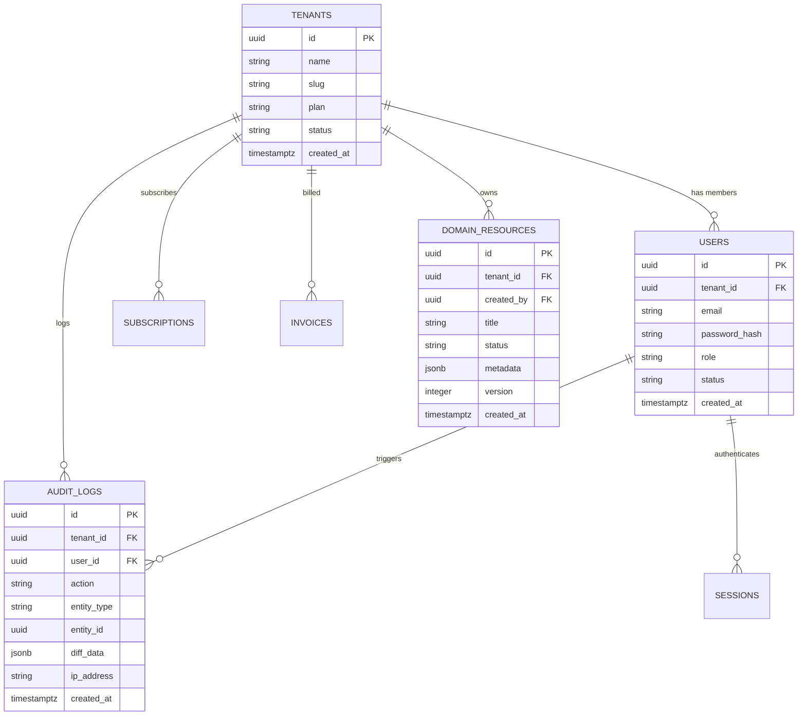

# Canonical Data Model & Relational Schema: Ekklesia

## 1. Entity-Relationship Diagram

---

## 2. Relational Entity Specifications

### Entity: `tenants`
- `id`: UUID (Primary Key, default `uuid_generate_v4()`)
- `name`: VARCHAR(120) NOT NULL
- `slug`: VARCHAR(120) UNIQUE NOT NULL
- `plan`: VARCHAR(30) DEFAULT 'free'
- `status`: VARCHAR(30) DEFAULT 'active'
- `settings`: JSONB DEFAULT '{}'
- `created_at`: TIMESTAMPTZ DEFAULT NOW()
- `updated_at`: TIMESTAMPTZ DEFAULT NOW()

### Entity: `users`
- `id`: UUID (Primary Key, default `uuid_generate_v4()`)
- `tenant_id`: UUID NOT NULL REFERENCES tenants(id) ON DELETE CASCADE
- `email`: VARCHAR(255) UNIQUE NOT NULL
- `password_hash`: VARCHAR(255) NOT NULL
- `role`: VARCHAR(30) DEFAULT 'member' CHECK (role IN ('super_admin', 'admin', 'member', 'viewer'))
- `status`: VARCHAR(30) DEFAULT 'active'
- `last_login_at`: TIMESTAMPTZ
- `created_at`: TIMESTAMPTZ DEFAULT NOW()

### Entity: `domain_resources`
- `id`: UUID (Primary Key, default `uuid_generate_v4()`)
- `tenant_id`: UUID NOT NULL REFERENCES tenants(id) ON DELETE CASCADE
- `created_by`: UUID REFERENCES users(id) ON DELETE SET NULL
- `title`: VARCHAR(200) NOT NULL
- `status`: VARCHAR(50) DEFAULT 'draft'
- `data`: JSONB DEFAULT '{}'
- `version`: INTEGER DEFAULT 1
- `created_at`: TIMESTAMPTZ DEFAULT NOW()
- `updated_at`: TIMESTAMPTZ DEFAULT NOW()
