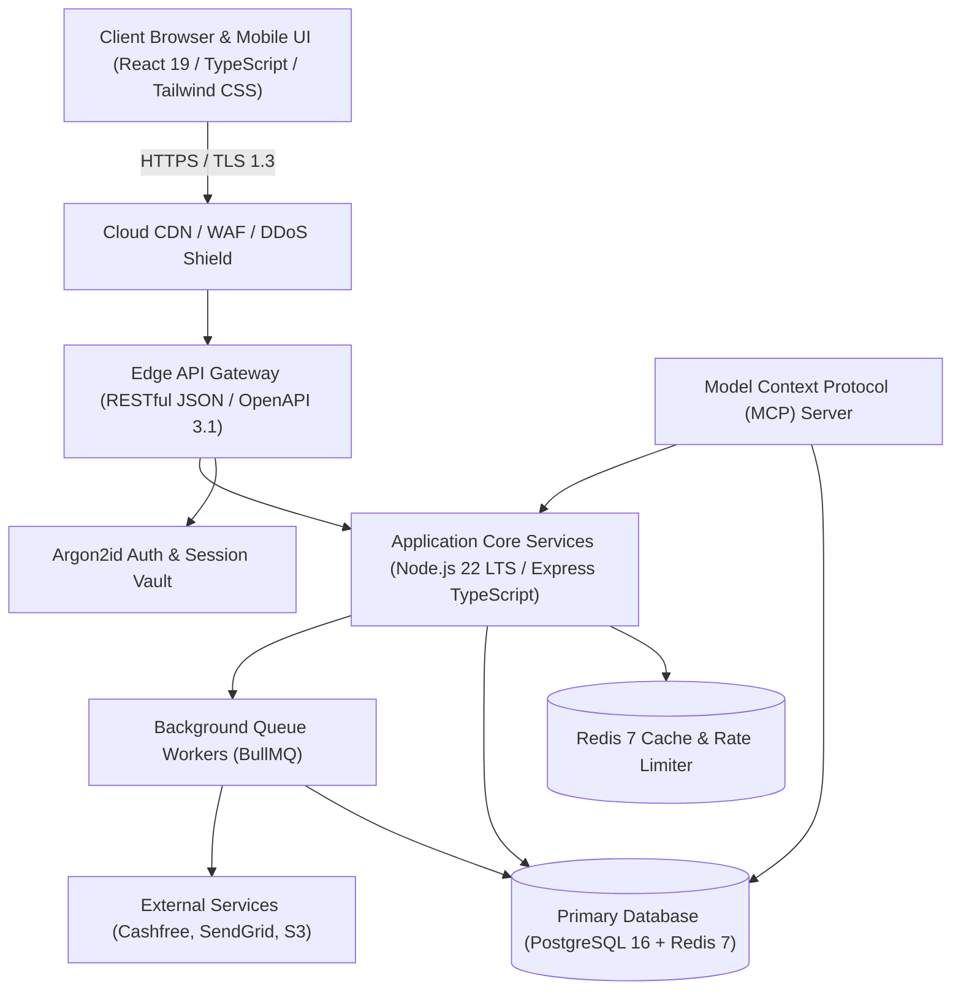

# System Design & Component Architecture: Ekklesia

## 1. System Topology Flowchart

---

## 2. Architectural Subsystems

### Edge API Gateway
- Terminates TLS 1.3 with automated SSL certificate rotation.
- Enforces IP rate limiting and DDoS mitigation via Redis sliding windows.
- Injects standardized correlation IDs (`X-Request-ID`) into all request headers.

### Application Core (Node.js 22 LTS / Express TypeScript)
- Structured as a **Modular Monolith with Domain-Driven Partitioning**.
- Enforces strict separation of concerns: Presentation -> Controller -> Service -> Repository -> Data Access.
- Operates statelessly: all user sessions are verified via JWT and Redis session stores.

### Storage & Persistence Layer (PostgreSQL 16 + Redis 7)
- PostgreSQL 16 relational database with connection pooling (PgBouncer).
- Multi-tenant partitioning enforced by Row-Level Security (RLS).
- Redis 7 used for L2 query caching, rate limit counters, and queue state.

### Background Queue Worker Fleet
- Asynchronous tasks (email delivery, invoice generation, webhooks, heavy AI spec synthesis) run out-of-band via Redis BullMQ.
- Retries transient errors up to 5 times with exponential backoff and dead-letter queues (DLQ).

---

## 3. Frontier Architecture Blueprint Synthesis

# Master Strategic Architecture Suite: Ekklesia
**Generated Date:** 2026-11-24

