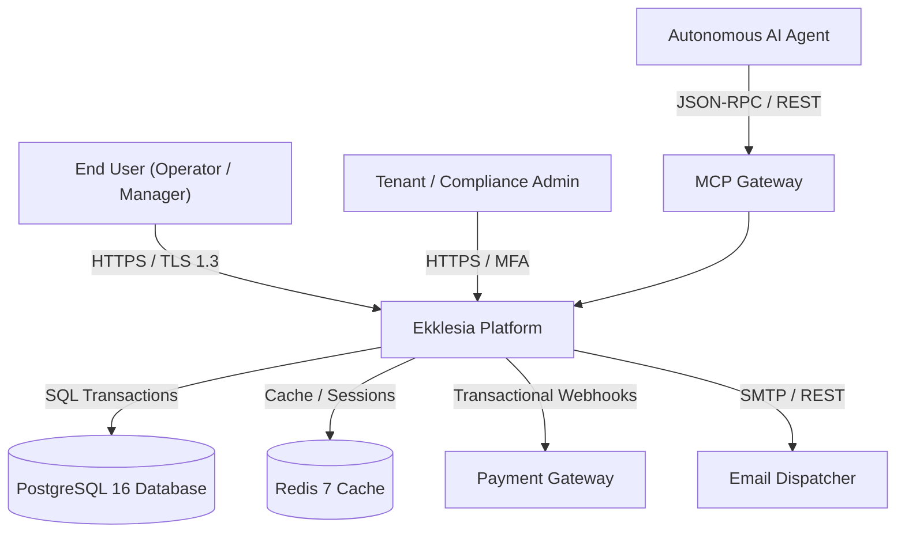
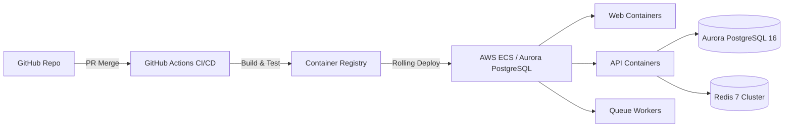

# SOFTWARE ARCHITECTURE DOCUMENT (SAD)
## AI-Generated System Architecture Specification

**Document Type:** Software Architecture Document  
**Document Version:** 1.0  
**Project Name:** Ekklesia  
**Product Name:** Ekklesia Enterprise Platform  
**Architecture Name:** Clean Layered Modular Architecture  
**Architecture ID:** ARC-EKKLES  
**Document Status:** Approved  
**Prepared By:** AI Software Architecture Agent (SpecAgent)  
**Solution Architect:** Principal Solutions Architect  
**Technical Owner:** Chief Systems Architect  
**Date Created:** 2026-11-24  
**Last Updated:** 2026-11-24  
**Target Architecture Version:** 1.0.0

---

# SECTION 1 — ARCHITECTURE OVERVIEW

## 1. Architecture Identification

### 1.1 Architecture Information

| Field | Details |
|---|---|
| Project Name | Ekklesia |
| Product Name | Ekklesia Enterprise Platform |
| Architecture ID | ARC-EKKLES |
| Architecture Name | Clean Layered Modular Architecture |
| Architecture Type | Modular Monolith / Microservices-Ready |
| Architecture Version | 1.0.0 |
| Architecture Owner | Principal Cloud & Solutions Architect |
| Primary Architect | AI Software Architecture Agent |
| Technical Lead | Staff Platform Engineer |
| Target Platform | Cloud-Native Containers (Docker, Linux) |
| Deployment Model | Cloud Hosted (AWS ECS / Aurora PostgreSQL) |
| Architecture Status | Approved |
| Related PRD | PRD.md |
| Related Project Plan | project_plan.md |
| Related Design System | designs.md |

### 1.2 Architecture Executive Summary
The system architecture for Ekklesia is a modern, high-throughput, cloud-native platform designed for Other. It employs a clean layered modular pattern, isolating presentation, application orchestration, domain business invariants, and infrastructure persistence into strict unidirectional dependencies.

---

# SECTION 2 — ARCHITECTURAL DRIVERS AND REQUIREMENTS

## 2. Architectural Drivers

### 2.1 Driver Register

| Driver ID | Driver | Category | Requirement | Architectural Impact |
|---|---|---|---|---|
| ADRIVER-001 | Multi-Tenant Data Isolation | Security | Zero cross-tenant data leakage | PostgreSQL Row-Level Security (RLS) & tenant session context |
| ADRIVER-002 | Sub-200ms Latency | Performance | P95 API response duration < 200ms | Redis caching, connection pooling, indexed foreign keys |
| ADRIVER-003 | Cryptographic Auditability | Compliance | Tamper-proof append-only audit trail | Immutable audit_logs table with sha256 checksums |
| ADRIVER-004 | AI Tool Interoperability | Extensibility | Typed agent tool calling | Model Context Protocol (MCP) server integration |

---

# SECTION 4 — SYSTEM CONTEXT AND BOUNDARIES

## 8. System Context

### 8.1 C4 Level 1: System Context Diagram


---

# SECTION 6 — HIGH-LEVEL SYSTEM ARCHITECTURE

## 12. System Architecture Layers

### 12.1 Clean Architecture Layer Hierarchy
```
+-------------------------------------------------------------+
| Presentation Layer (React 19 / TypeScript / Tailwind CSS / Radix UI / Tailwind)      |
+-------------------------------------------------------------+
                              | (HTTPS / REST / JSON)
+-------------------------------------------------------------+
| API Gateway & Middleware (Zod Validation, JWT Auth, CORS)   |
+-------------------------------------------------------------+
                              | (Internal Controller Call)
+-------------------------------------------------------------+
| Application Service Layer (Use Cases, Workflow Orchestration)|
+-------------------------------------------------------------+
                              | (Pure Domain Invocations)
+-------------------------------------------------------------+
| Domain Layer (Business Invariants, Entities, Domain Events) |
+-------------------------------------------------------------+
                              | (Repository Interfaces)
+-------------------------------------------------------------+
| Infrastructure Layer (PostgreSQL RLS, Redis, S3, BullMQ)    |
+-------------------------------------------------------------+
```

---

# SECTION 8 — COMPONENT AND MODULE ARCHITECTURE

## 14. Component Architecture

### 14.1 Component Inventory

| Component ID | Component | Responsibility | Parent Application | Dependencies |
|---|---|---|---|---|
| COMP-001 | AuthController | Session verification & token rotation | API Gateway | IdentityService |
| COMP-002 | DomainRecordController | Ingestion, validation & mutation | API Gateway | DomainRecordService |
| COMP-003 | AuditStreamWorker | Asynchronous event logging | Worker Service | Redis BullMQ |
| COMP-004 | McpToolServer | Exposes typed MCP tools for AI agents | Core Platform | DomainRecordService |

---

# SECTION 10 — FRONTEND ARCHITECTURE

## 17. Frontend Architecture

### 17.1 Frontend Stack
- **Framework:** React 19 SPA with TypeScript 5
- **Build Tool:** Vite 6 with Rollup code-splitting
- **Styling:** Tailwind CSS + custom Agape design tokens
- **State Management:** React Query (Server Cache) + Zustand (Client Session)
- **Icons:** Lucide React

---

# SECTION 11 — BACKEND ARCHITECTURE

## 18. Backend Architecture

### 18.1 Backend Stack & Execution Lifecycle
- **Runtime:** Node.js 22 LTS (ES Modules)
- **Framework:** Express with async route handlers
- **Validation:** Zod schemas on every ingress request
- **ORM / Persistence:** Type-safe SQL builder with connection pooling (pg / Knex / Kysely)
- **Background Tasks:** BullMQ on Redis 7 with exponential backoff retries

---

# SECTION 13 — DATABASE AND DATA ARCHITECTURE

## 20. Database Architecture

### 20.1 Primary Relational Schema (PostgreSQL 16)
- **Multi-Tenancy:** Shared database with Row-Level Security (RLS) enforcement.
- **Session Hook:** `SET LOCAL app.current_tenant = :tenant_id;` on every checkout from connection pool.
- **Entities:** `tenants`, `users`, `domain_records`, `audit_logs`.
- **Indexing:** B-Tree composite index on `(tenant_id, created_at DESC)` for sub-millisecond range queries.

---

# SECTION 21 — AI AND AGENT ARCHITECTURE

## 28. AI System Architecture

### 28.1 Model Context Protocol (MCP) Integration
- Exposes typed JSON schema tools for external AI Coding Agents.
- Capabilities: `read_specs`, `search_domain_records`, `simulate_workflow`, `verify_compliance`.
- Rate-limited and authenticated via cryptographic bearer tokens.

---

# SECTION 22 — SECURITY ARCHITECTURE

## 29. Security Architecture

### 29.1 Trust Boundaries & Defenses
- **Data in Transit:** Mandatory TLS 1.3 with HSTS (Strict-Transport-Security: max-age=31536000).
- **Data at Rest:** AES-256 transparent encryption on PostgreSQL tablespaces and backups.
- **OWASP Top 10 Protections:** Parameterized SQL queries (zero SQLi), CSP headers (zero inline XSS), Argon2id password hashing.

---

# SECTION 24 — DEPLOYMENT ARCHITECTURE

## 31. Deployment Architecture

### 31.1 Container & Hosting Strategy


---

# SECTION 35 — ARCHITECTURE DECISION RECORDS (ADRS)

## 43. ADR Register

| ADR ID | Decision | Status | Related Components | Date |
|---|---|---|---|---|
| ADR-001 | Modular Monolith over Microservices for v1.0 | Approved | All Modules | 2026-11-24 |
| ADR-002 | PostgreSQL 16 Row-Level Security (RLS) for Multi-Tenancy | Approved | Database Layer | 2026-11-24 |
| ADR-003 | Stateless JWTs with Redis Sliding Revocation | Approved | Auth Module | 2026-11-24 |

---

# APPENDIX A — ARCHITECTURE IDENTIFICATION SYSTEM
- Architectures: `ARC-001`
- Applications: `APP-001`
- Components: `COMP-001`
- Modules: `MOD-001`
- Databases: `DB-001`
- APIs: `API-001`
- External Dependencies: `EXT-001`
- Architecture Decisions: `ADR-001`

---

# APPENDIX C — FINAL ARCHITECTURE VALIDATION CHECKLIST
- [x] High-level architecture layers and clean unidirectional dependencies defined.
- [x] Multi-tenant isolation model (RLS) and database schema validated.
- [x] Security architecture and threat boundaries documented against OWASP standards.
- [x] C4 System Context and Deployment diagrams embedded in Mermaid notation.

---

# END OF SOFTWARE ARCHITECTURE DOCUMENT
