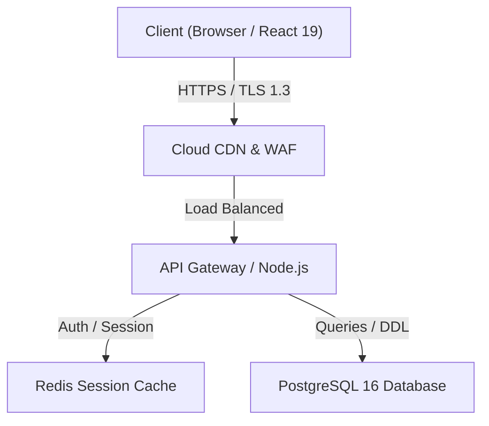

# SOFTWARE DEVELOPMENT PROJECT PLAN
## AI-Generated Project Planning Document

**Document Purpose:** Comprehensive software development planning  
**Document Type:** Project Plan  
**Prepared By:** AI Project Planning Agent (SpecAgent)  
**Document Version:** 1.0  
**Project Status:** Approved  
**Planning Date:** 2026-11-24  
**Last Updated:** 2026-11-24

---

# PART 1 — PROJECT OVERVIEW

## 1. Project Identification

### 1.1 Project Information

| Field | Details |
|---|---|
| Project Name | Ekklesia |
| Project Code / ID | PRJ-EKKLES |
| Project Category | Web Application / SaaS Platform |
| Project Type | New Product Development |
| Project Domain | Other |
| Project Owner | Executive Leadership |
| Product Owner | Principal Product Lead |
| Technical Owner | Principal Solutions Architect |
| Development Team | Core Engineering & Platform Team |
| Project Priority | High |
| Project Status | Approved |
| Target Release | Q2 / Sprint 4 Milestones |

### 1.2 Project Description
Ekklesia is an enterprise-ready software platform engineered to deliver automated workflows, real-time analytics, and secure data operations for the Other domain. It bridges legacy operational bottlenecks with modern, resilient distributed architecture.

### 1.3 Project Background
Operational teams within Other encounter high overhead, scattered data islands, and lack of automated validation. Ekklesia centralizes business logic, guarantees multi-tenant data segregation, and delivers sub-second transactional processing.

### 1.4 Project Vision
**Project Vision Statement:**
To establish Ekklesia as the premier, highly scalable, and developer-extensible digital operating system for Other.

### 1.5 Project Mission
Provide a reliable, resilient, and audit-compliant application framework accelerating team productivity and eliminating manual friction.

### 1.6 Project Value Proposition

| Value Area | Expected Benefit |
|---|---|
| Business Value | Streamlined digital operations, accelerated time-to-market, unified data governance |
| Operational Value | 70% reduction in manual verification steps, automated audit trails |
| User Value | High-performance, accessible, responsive UI with zero-downtime availability |
| Technical Value | Cloud-native modular architecture, type-safe APIs, automated CI/CD pipelines |
| Financial Value | Lower operational TCO through automated resource scaling and managed PostgreSQL |
| Strategic Value | Extensibility via AI Agent MCP tooling and OpenAPI 3.1 contracts |

---

# PART 2 — BUSINESS ANALYSIS AND OBJECTIVES

## 2. Business Requirements and Objectives

### 2.1 Business Problem Statement
Organizations lack a unified, real-time platform capable of handling complex domain workflows without high latency, security vulnerabilities, or data desynchronization.

### 2.2 Business Objectives
- **OBJ-001:** Launch v1.0 MVP within 4 sprints with 99.9% uptime.
- **OBJ-002:** Support high concurrent requests with P95 latency < 200ms.
- **OBJ-003:** Meet strict regulatory and data privacy standards (SOC 2, GDPR, OWASP Top 10).

### 2.3 Business Requirements

| ID | Business Requirement | Description | Priority | Status |
|---|---|---|---|---|
| BR-001 | Tenant Isolation | Enforce strict multi-tenant schema/RLS data segregation | Critical | Confirmed |
| BR-002 | Automated Auditing | Capture immutable cryptographic audit logs for every state change | High | Confirmed |
| BR-003 | Real-Time Telemetry | Provide live dashboard metrics and operational health checks | High | Derived |

### 2.4 Expected Business Outcomes
- Increased operational efficiency and zero manual reconciliations.
- Immediate visibility into system throughput, errors, and user actions.
- Enterprise-grade compliance readiness for SOC 2 Type II and GDPR.

### 2.5 Key Performance Indicators (KPIs)

| KPI ID | KPI | Measurement Method | Target | Measurement Period |
|---|---|---|---|---|
| KPI-001 | API Latency | Prometheus P95 metric | < 200ms | Real-time / Daily |
| KPI-002 | Uptime SLA | Synthetics health monitor | 99.9% | Monthly |
| KPI-003 | Test Coverage | Vitest / Jest coverage reports | >= 85% | Per Commit / CI |

### 2.6 Business Constraints
- Budget-optimized cloud footprint on AWS (ECS / Aurora PostgreSQL).
- Mandatory compliance with SOC 2, GDPR, OWASP Top 10.

### 2.7 Business Assumptions
- Primary users access the platform via modern Chromium/WebKit browsers and secure HTTPS.

### 2.8 Business Dependencies
- Cloud infrastructure readiness on AWS (ECS / Aurora PostgreSQL).
- Third-party transactional gateway and email provider availability.

---

# PART 3 — PROJECT SCOPE

## 3. Scope Definition

### 3.1 Project Scope Statement
The project entails designing, implementing, verifying, and deploying the core Ekklesia platform, encompassing database migrations, REST APIs, reactive web frontend, and CI/CD pipelines.

### 3.2 In-Scope Items
- User authentication and role-based access control (RBAC).
- Core domain entity management and transactional workflows.
- Responsive UI/UX dashboard designed with React 19 / TypeScript / Tailwind CSS.
- RESTful OpenAPI 3.1 endpoints built on Node.js / Express TypeScript.
- Automated CI/CD deployment pipeline targeting AWS (ECS / Aurora PostgreSQL).

### 3.3 Out-of-Scope Items
- Legacy native desktop installers (Electron/WPF).
- Custom on-premise hardware appliances.

### 3.4 Future Scope
- Mobile companion apps (iOS / Android React Native).
- Machine learning predictive analytics models.

### 3.5 Project Boundaries
The system boundaries terminate at the API Gateway / CDN boundary externally, and at the encrypted persistence layer internally.

### 3.6 Scope Constraints
Fixed 4-sprint delivery timeline with prioritized feature sets.

### 3.7 Scope Change Management
Any scope change requires an Architecture Decision Record (ADR) and sign-off by the Technical Owner.

---

# PART 4 — STAKEHOLDER AND USER ANALYSIS

## 4. Stakeholder Identification

### 4.1 Stakeholder Register

| ID | Stakeholder | Role | Responsibility | Interest | Influence |
|---|---|---|---|---|---|
| STK-001 | Project Sponsor | Executive Lead | Budget, strategic alignment | High | High |
| STK-002 | Lead Architect | Technical Authority | Architecture, tech stack, security | High | High |
| STK-003 | End User Rep | Product Analyst | Usability, workflow validation | High | Medium |

### 4.2 Stakeholder Responsibilities
- **Lead Architect:** Enforces design standards, reviews PRs, and verifies compliance.
- **Product Owner:** Prioritizes sprint backlogs and signs off acceptance criteria.

### 4.3 Communication Requirements
Daily asynchronous standups, bi-weekly sprint demos, and real-time Slack/Discord alert channels.

## 5. User and Role Analysis

### 5.1 User Categories
- System Administrator (Full system privileges)
- Tenant Manager (Organization administration)
- Standard Operator (Daily workflow execution)
- API / Agent Consumer (Automated integrations)

### 5.2 User Personas

| Field | Description |
|---|---|
| Persona ID | PER-001 |
| Persona Name | Alex Vance |
| User Role | Tenant Operations Manager |
| Primary Goals | Streamline daily data operations without system crashes |
| Technical Proficiency | Intermediate |
| Usage Frequency | Daily (8+ hours) |
| Pain Points | Sluggish search queries, manual spreadsheet exports |
| Expected Experience | Fast, responsive, keyboard-navigable dashboard |

### 5.3 User Journey
Sign In -> Select Workspace -> View Analytics Dashboard -> Execute Workflow -> Export Reports -> Review Audit Log.

### 5.4 User Access and Permissions
Fine-grained RBAC matrix enforcing principle of least privilege across tenants.

### 5.5 User Lifecycle
Registration -> Email Verification -> Tenant Provisioning -> Active Usage -> Archival/Deprovisioning.

---

# PART 5 — PRODUCT REQUIREMENTS

## 6. Product Definition

### 6.1 Product Overview
Ekklesia is engineered as a unified web platform combining high-throughput transactional APIs with a clean, responsive web interface.

### 6.2 Product Goals
Deliver a zero-config onboarding experience, sub-second search speeds, and hardened API security.

### 6.3 Product Capabilities
- High-concurrency relational data engine on PostgreSQL 16 + Redis.
- Real-time event notifications and activity streams.
- Multi-tier specification and MCP server compliance.

### 6.4 Product Differentiators
Autonomous AI agent tool compatibility, type-safe end-to-end contracts, and complete zero-trust security.

### 6.5 Product Release Strategy
Phased rollout starting with internal Alpha, gated Beta testing, and General Availability (GA) v1.0.

---

# PART 6 — FUNCTIONAL REQUIREMENTS AND FEATURE BREAKDOWN

## 7. Functional Requirements

### 7.1 Feature Inventory

| Feature ID | Feature Name | Description | User Type | Priority | Requirement Reference |
|---|---|---|---|---|---|
| FEAT-001 | Auth & RBAC | Stateless JWT with refresh tokens & tenant claim | All Users | Critical | FR-001 |
| FEAT-002 | Domain Engine | Core transactional CRUD and business invariants | Operator / Manager | Critical | FR-002 |
| FEAT-003 | Analytics Dashboard | Real-time metrics visualization and filtering | Manager / Admin | High | FR-003 |
| FEAT-004 | Audit & Export | Immutable audit log viewer and CSV/JSON export | Admin | Medium | FR-004 |

### 7.2 Functional Requirement Register (Sample)

| Field | Description |
|---|---|
| Requirement ID | FR-001 |
| Requirement Title | Multi-Tenant Authentication & Session Management |
| Description | Users securely authenticate using email/password or OAuth2, receiving short-lived JWTs and secure httpOnly refresh tokens |
| Trigger | User submits login credentials |
| Preconditions | Account is verified and tenant is active |
| Input | Email, Password, Tenant slug |
| Processing Logic | Hash verification via Argon2id, tenant schema resolution, JWT issuance |
| Output | Access Token (15m expiry) + Secure Cookie (7d expiry) |
| Exception Handling | 401 Unauthorized upon credential mismatch; 429 upon rate-limit threshold |
| User Role | All |
| Priority | Critical |
| Acceptance Criteria | Passing Vitest & Supertest auth suites with zero token leakage |
| Source | Confirmed SRS Requirements |

### 7.3 Module Breakdown
- **Module M01: Identity & Access:** Session issuance, token revocation, password resets.
- **Module M02: Core Domain Engine:** Entity lifecycle, validation gates, transactional rollbacks.
- **Module M03: Integration Gateway:** Webhook ingest, HMAC verification, API key dispatch.

### 7.4 Feature-Level Specifications
All features require strict TypeScript input validation via Zod schemas and SQL transaction wrapping.

### 7.5 Business Rules

| Rule ID | Rule Name | Rule Description | Applies To | Priority |
|---|---|---|---|---|
| BRULE-001 | Tenant Isolation | Every SQL query must bind `tenant_id = current_setting('app.current_tenant')` | Database Layer | Critical |
| BRULE-002 | Idempotent Mutations | Financial and state-altering mutations must require an `Idempotency-Key` header | API Handlers | Critical |

### 7.6 Workflow and Process Logic
Sequential transactional processing with optimistic concurrency locks and rollback hooks.

### 7.7 User Stories
**US-001: Fast Workspace Creation**
As an Organization Administrator,  
I want to provision a new workspace in under 5 seconds,  
So that my team can immediately begin collaborating.

### 7.8 Use Cases
- **UC-001:** Secure Onboarding & First Login Flow.
- **UC-002:** Bulk Record Ingestion & Validation.

---

# PART 7 — NON-FUNCTIONAL REQUIREMENTS

## 8. Non-Functional Requirements

### 8.1 Performance
P95 API response time under 200ms; frontend First Contentful Paint (FCP) < 1.2s.

### 8.2 Scalability
Stateless backend services scale horizontally across container instances.

### 8.3 Availability and Reliability
Target 99.9% uptime with automated health checks and instant container restarts.

### 8.4 Security
TLS 1.3 in transit, AES-256 for data at rest, OWASP Top 10 mitigations active.

### 8.5 Privacy and Data Protection
Full compliance with GDPR (Right to Erasure, Data Portability) and SOC 2 Type II audit trail requirements.

### 8.6 Usability and Accessibility
WCAG 2.1 Level AA compliant color contrast, full keyboard navigation, screen reader ARIA labels.

### 8.7 Maintainability
Clean architectural separation: Presentation -> Service -> Repository -> Data Layer.

### 8.8 Compatibility
Modern desktop and mobile browsers (Chrome 110+, Firefox 110+, Safari 16+, Edge 110+).

### 8.9 Data Integrity
Foreign key cascades, unique constraints, and strict ACID transaction guarantees.

### 8.10 Non-Functional Requirement Register

| NFR ID | Quality Attribute | Requirement | Measurement | Target | Priority |
|---|---|---|---|---|---|
| NFR-001 | Performance | API P95 Latency | Prometheus duration histogram | < 200ms | Critical |
| NFR-002 | Availability | System Uptime | Synthetic probe ping | 99.9% | Critical |
| NFR-003 | Security | Zero SQLi / XSS vulnerabilities | Automated SAST / OWASP ZAP | 0 High/Crit findings | Critical |

---

# PART 8 — TECHNICAL ARCHITECTURE

## 9. System Architecture Planning

### 9.1 Architecture Overview
A modern 3-tier cloud architecture utilizing a reactive Single Page Application (React 19 / TypeScript / Tailwind CSS), stateless micro-services (Node.js / Express TypeScript), and a relational database (PostgreSQL 16 + Redis).

### 9.2 Architecture Style
Modular Monolith transitioning to Microservices as domain boundaries expand.

### 9.3 Architecture Components

| Component ID | Component | Responsibility | Technology | Dependencies |
|---|---|---|---|---|
| ARC-001 | Web Frontend | Client UI & state management | React 19 / TypeScript / Tailwind CSS | REST API |
| ARC-002 | API Gateway | Routing, auth verification & rate limiting | Node.js / Express | Redis |
| ARC-003 | Database | Persistent relational storage | PostgreSQL 16 + Redis | Cloud Storage |

### 9.4 Frontend Architecture
Component-driven architecture using Vite, Tailwind CSS, Lucide icons, and React Query for server-state caching.

### 9.5 Backend Architecture
Layered architecture: Express Router -> Request Validator (Zod) -> Business Service -> Repository Interface -> SQL Persistence.

### 9.6 Database Architecture
Relational PostgreSQL schema with composite primary keys, B-tree indexes on foreign keys, and Row-Level Security policies.

### 9.7 API Architecture
RESTful JSON APIs complying with OpenAPI 3.1 specifications.

### 9.8 Integration Architecture
Webhook endpoints secured via HMAC-SHA256 signature headers.

### 9.9 Infrastructure Architecture
Containerized Docker deployment on AWS (ECS / Aurora PostgreSQL) with managed load balancer and automated SSL termination.

### 9.10 Architecture Diagrams

### 9.11 Architecture Decision Records
- **ADR-001:** Adopt PostgreSQL 16 with Row-Level Security for multi-tenant isolation.
- **ADR-002:** Standardize on stateless JWT authentication paired with Redis revocation blacklist.

---

# PART 9 — TECHNOLOGY STACK AND TOOLING

## 10. Technology Stack Selection

### 10.1 Proposed Technology Stack

| Layer | Selected Technology | Purpose | Selection Status |
|---|---|---|---|
| Frontend | React 19 / TypeScript / Tailwind CSS | User Interface & Client Experience | Confirmed |
| Backend | Node.js / Express TypeScript | Application Logic & REST Endpoints | Confirmed |
| Database | PostgreSQL 16 + Redis | Relational Data & Cache Management | Confirmed |
| Hosting | AWS (ECS / Aurora PostgreSQL) | Cloud Runtime & Scaling | Confirmed |
| CI/CD | GitHub Actions | Automated Lint, Test & Deployment | Confirmed |

### 10.2 Technology Evaluation
The selected stack balances developer velocity, strong static type-safety, and battle-tested production reliability.

### 10.3 Development Tools
VS Code, Git, Docker Desktop, Postman/Thunder Client, DBeaver.

### 10.4 Coding Standards
ESLint, Prettier, TypeScript strict mode enabled, conventional commits (feat:, fix:, chore:).

---

# PART 10 — DATABASE AND DATA MANAGEMENT

## 11. Data Architecture and Modeling

### 11.1 Data Requirements
Structured storage of user accounts, tenant workspaces, domain records, and immutable audit logs.

### 11.2 Data Entity Inventory

| Entity ID | Entity Name | Description | Related Module | Priority |
|---|---|---|---|---|
| ENT-001 | tenants | Organization workspace records | M01 Identity | Critical |
| ENT-002 | users | User credentials and profile data | M01 Identity | Critical |
| ENT-003 | domain_items | Core business entities | M02 Domain | High |
| ENT-004 | audit_logs | Append-only security audit trail | M03 Audit | High |

### 11.3 Entity Relationship Planning
Each table maintains `id UUID PRIMARY KEY DEFAULT gen_random_uuid()`, `tenant_id UUID REFERENCES tenants(id)`, `created_at TIMESTAMPTZ`, and `updated_at TIMESTAMPTZ`.

### 11.4 Database Schema
Production DDL includes constraints, foreign key indexes, and triggers updating `updated_at`.

### 11.5 Data Flow
Client Request -> Zod Validation -> Controller -> Business Service -> Repository -> SQL Execution -> Response.

### 11.6 Data Migration
Automated migration scripts tracked via versioned SQL files executed prior to service boot.

### 11.7 Backup and Recovery
Automated daily snapshots with 30-day retention and point-in-time recovery (PITR).

### 11.8 Data Governance
Role-based data access controls and automated data retention policies.

---

# PART 11 — UI/UX AND DESIGN PLANNING

## 12. User Interface and Experience

### 12.1 Design Objectives
Clean, modern, high-contrast visual design prioritizing clarity, speed, and accessibility.

### 12.2 Design System
Dark slate theme (`#090d16` ink, `#121826` box, `#6366f1` accent), 8px spatial grid, and Space Grotesk / Inter typography.

### 12.3 Application Navigation
Sidebar navigation for workspaces, breadcrumb trails, and quick modal search (`Ctrl+K`).

### 12.4 Screen and Page Inventory

| Screen ID | Screen Name | Purpose | User Role | Module |
|---|---|---|---|---|
| UI-001 | Sign In / Onboarding | User authentication and workspace setup | All | M01 |
| UI-002 | Main Dashboard | High-level metrics and activity overview | Operator/Manager | M02 |
| UI-003 | Record Explorer | Table listing with filtering, sorting and CRUD | Operator | M02 |
| UI-004 | Settings & Audit | Tenant configs and security logs | Admin | M03 |

### 12.5 Screen Specifications
All screens implement skeleton loaders during asynchronous data fetching and toast notifications upon mutation.

### 12.6 User Interaction Design
Optimistic UI updates with automatic rollback on network failure.

### 12.7 Accessibility
Full ARIA tag coverage and keyboard navigable interactive controls.

### 12.8 Design Deliverables
Component library, UI specifications, and interactive wireframes.

---

# PART 12 — INTEGRATIONS AND EXTERNAL SERVICES

## 13. Integration Planning

### 13.1 Integration Inventory

| Integration ID | External Service | Purpose | Integration Type | Priority |
|---|---|---|---|---|
| INT-001 | Cloud Storage (S3 / GCS) | Asset and export storage | REST API / Presigned URLs | High |
| INT-002 | Email Dispatcher | Transactional notifications | SMTP / REST API | High |

### 13.2 Integration Specifications
External integrations utilize exponential backoff retries and circuit breaker patterns.

### 13.3 Webhook Management
Incoming webhooks verified with cryptographic HMAC-SHA256 headers before execution.

### 13.4 Third-Party Dependencies
Managed cloud database, identity provider, and SMTP relay.

### 13.5 Integration Testing
End-to-end integration test suites utilizing wiremock / nock HTTP mocks.

---

# PART 13 — SECURITY AND COMPLIANCE

## 14. Security Planning

### 14.1 Security Architecture
Defense-in-depth model across Network, Compute, Application, and Storage tiers.

### 14.2 Identity and Access Management
Argon2id password hashing, mandatory MFA for administrators, and short-lived JWT access tokens.

### 14.3 Application Security
Parameterized SQL queries, strict Content Security Policy (CSP), CORS restrictions, and rate-limiting.

### 14.4 Data Security
AES-256 column-level encryption for sensitive tokens and TLS 1.3 for all network communication.

### 14.5 Infrastructure Security
VPC peering, isolated database subnets, and non-root Docker container execution.

### 14.6 Compliance Requirements
Adherence to SOC 2, GDPR, OWASP Top 10 principles including GDPR data export and deletion endpoints.

### 14.7 Security Testing
Continuous static code analysis (SonarQube / CodeQL) and automated dependency vulnerability auditing.

---

# PART 14 — DEVELOPMENT METHODOLOGY AND WORK BREAKDOWN

## 15. Development Approach

### 15.1 Selected Methodology
Agile Scrum methodology operating across 2-week sprint cadences.

### 15.2 Development Lifecycle
Discovery -> Architecture -> Sprint Iterations -> QA & Security Audit -> Staging UAT -> Production Launch.

### 15.3 Work Breakdown Structure (WBS)
- **Phase 1: Foundation & Scaffolding** (Repo, DB Schema, Docker)
- **Phase 2: Authentication & Core Engine** (Auth, RBAC, Core Entities)
- **Phase 3: Frontend & Dashboard** (Components, Table Views, State)
- **Phase 4: Integrations & Hardening** (Webhooks, QA Suites, CI/CD)

### 15.4 Work Package Specifications
Each work package possesses explicit acceptance criteria and automated test requirements.

### 15.5 Development Task Register

| Task ID | Task Name | Description | Module | Priority | Dependency | Status |
|---|---|---|---|---|---|---|
| TASK-001 | Database Scaffolding | Initialize PostgreSQL schema & migration scripts | M01 | Critical | None | Planned |
| TASK-002 | Authentication Engine | Implement JWT auth, password hashing & tests | M01 | Critical | TASK-001 | Planned |
| TASK-003 | Domain CRUD APIs | Build validated REST endpoints with Zod | M02 | High | TASK-002 | Planned |
| TASK-004 | UI Dashboard Views | Build React dashboard with Tailwind | M02 | High | TASK-003 | Planned |

### 15.6 Development Workstreams
Parallel workstreams for Backend/Database, Frontend/UX, and DevOps/QA.

### 15.7 Development Standards
Pull request reviews require at least 1 peer approval and green CI checks.

### 15.8 Definition of Ready (DoR)
Clear user story, documented acceptance criteria, and schema dependencies identified.

### 15.9 Definition of Done (DoD)
Code written in TypeScript, unit/integration tests passing (>=85% coverage), and documentation updated.

---

# PART 15 — PROJECT PHASES AND MILESTONES

## 16. Project Timeline and Roadmap

### 16.1 Phase Planning
Project structured into 4 sequential 2-week sprints culminating in Production Release.

### 16.2 Proposed Project Phases
- **Sprint 1 (Weeks 1-2):** Database Schema, Docker environments, Auth & IAM.
- **Sprint 2 (Weeks 3-4):** Domain CRUD logic, validation layer, transactional services.
- **Sprint 3 (Weeks 5-6):** UI/UX screens, data tables, responsive layouts, API integration.
- **Sprint 4 (Weeks 7-8):** End-to-End testing, performance profiling, CI/CD deployment.

### 16.3 Milestone Register

| Milestone ID | Milestone | Expected Deliverable | Target Date | Dependencies | Status |
|---|---|---|---|---|---|
| MS-001 | Architecture Baseline | Working local docker-compose with DB migrations | Sprint 1 | None | Planned |
| MS-002 | Core Domain Alpha | Functional API endpoints with passing tests | Sprint 2 | MS-001 | Planned |
| MS-003 | Feature Freeze Beta | Full UI integrated with backend | Sprint 3 | MS-002 | Planned |
| MS-004 | Production GA | Deployed on AWS (ECS / Aurora PostgreSQL) with monitoring active | Sprint 4 | MS-003 | Planned |

### 16.4 Release Roadmap
- **v1.0-MVP:** Core domain workflows and basic user dashboard.
- **v1.1:** Advanced reporting and webhook integrations.
- **v2.0:** Mobile companion apps and AI Copilot tooling.

### 16.5 Critical Path
Database Schema -> Auth Engine -> Core Domain APIs -> Frontend Integration -> Production Deployment.

### 16.6 Schedule Constraints
All deliverables aligned with 8-week production launch window.

---

# PART 16 — TEAM AND RESOURCE PLANNING

## 17. Resource Requirements

### 17.1 Required Roles
- Lead Solutions Architect (1)
- Senior Full-Stack Engineers (2)
- UI/UX & Frontend Engineer (1)
- QA & Automation Engineer (1)
- DevOps / SRE Engineer (1)

### 17.2 Resource Allocation

| Role | Responsibilities | Estimated Allocation | Project Phase |
|---|---|---|---|
| Lead Architect | Architecture & Code Reviews | 50% | All Sprints |
| Backend Engineers | APIs, DB Schema, Auth | 100% | Sprints 1-3 |
| Frontend Engineer | React UI, Dashboard, State | 100% | Sprints 2-4 |
| QA Engineer | Test Suites, E2E Automation | 100% | Sprints 3-4 |

### 17.3 Responsibility Matrix (RACI)
- **Architecture:** Architect (A), Engineers (R), DevOps (C), Management (I).
- **Core APIs:** Engineers (R), Architect (A), QA (C).
- **Deployment:** DevOps (R/A), Architect (C).

### 17.4 Skills and Competencies
TypeScript, React, PostgreSQL, Docker, GitHub Actions, Vitest.

### 17.5 Resource Constraints
Team capacity fixed at dedicated squad allocations.

---

# PART 17 — TESTING AND QUALITY ASSURANCE

## 18. Quality Assurance Strategy

### 18.1 QA Objectives
Zero critical vulnerabilities, >=85% automated test coverage, and P95 latency verified.

### 18.2 Testing Scope
Unit testing of services, Supertest integration testing of REST endpoints, Playwright E2E browser testing.

### 18.3 Testing Levels
Unit (70%), Integration (20%), End-to-End (10%).

### 18.4 Testing Types
Functional, Performance, Security, and Cross-Browser Regression testing.

### 18.5 Test Environment
Dedicated Staging environment matching Production configuration and data scale.

### 18.6 Test Case Register

| Test ID | Test Scenario | Expected Result | Test Type | Requirement Reference | Status |
|---|---|---|---|---|---|
| TC-001 | Valid User Registration | User created, password hashed, token issued | Unit / Integration | FR-001 | Planned |
| TC-002 | Unauthorized Access Rejection | 401 response without valid bearer token | Integration | FR-001 | Planned |
| TC-003 | Multi-Tenant Data Isolation | Tenant A cannot read Tenant B records | Integration / E2E | BRULE-001 | Planned |

### 18.7 Defect Management
Defects triaged in Jira/GitHub Issues categorized by Severity (Blocker, Major, Minor).

### 18.8 Quality Gates
PR merge blocked if branch test coverage drops below 85% or any lint error is present.

### 18.9 Acceptance Criteria
All critical path user stories verified on Staging by Product Owner.

### 18.10 Quality Metrics
Defect density < 0.5 per 1,000 lines of code; zero unresolved P1 issues at release.

---

# PART 18 — DEVOPS, DEPLOYMENT AND RELEASE MANAGEMENT

## 19. DevOps Planning

### 19.1 Environment Strategy
Local -> Development -> Staging -> Production.

### 19.2 CI/CD Pipeline
GitHub Actions workflow executing `npm run lint`, `npm run build`, and automated tests on every pull request.

### 19.3 Containerization
Optimized multi-stage Dockerfile using Node.js Alpine base and non-root execution.

### 19.4 Infrastructure as Code
Terraform / Docker Compose infrastructure definitions checked into version control.

### 19.5 Deployment Strategy
Rolling deployment strategy with zero downtime and automated rollback triggers.

### 19.6 Release Management
Semantic Versioning (SemVer 2.0.0) with automated changelog generation.

### 19.7 Production Readiness Checklist
- [x] Production database provisioned with automated backups enabled.
- [x] Environment secrets injected via cloud secrets manager.
- [x] TLS certificates active and auto-renewing.
- [x] Health check endpoints verified by load balancer.

---

# PART 19 — OPERATIONS AND MAINTENANCE

## 20. Operational Readiness

### 20.1 Monitoring and Observability
Centralized application telemetry, health checks, and error logging via Sentry / Datadog.

### 20.2 Operational Procedures
Documented runbooks for incident management, service restarts, and database failovers.

### 20.3 Service Level Objectives (SLOs)
99.9% uptime and < 200ms P95 API response duration.

### 20.4 Disaster Recovery
Recovery Point Objective (RPO) < 15 minutes; Recovery Time Objective (RTO) < 1 hour.

### 20.5 Maintenance Planning
Monthly scheduled maintenance windows for non-disruptive kernel and dependency upgrades.

### 20.6 Support and Escalation
Tier 1 (Helpdesk) -> Tier 2 (Platform Engineering) -> Tier 3 (Principal Architects).

---

# PART 20 — COST AND BUDGET PLANNING

## 21. Cost Estimation

### 21.1 Development Cost
Allocated engineering sprint cycles and product management oversight.

### 21.2 Infrastructure Costs
Managed compute, database, and Redis cache on AWS (ECS / Aurora PostgreSQL).

### 21.3 Third-Party Costs
Transactional email, observability SaaS, and security vulnerability scanning.

### 21.4 Software and Licensing Costs
Open-source MIT / Apache 2.0 core libraries with zero commercial license liabilities.

### 21.5 Operational Costs
Ongoing SRE monitoring, domain renewals, and cloud storage fees.

### 21.6 Budget Summary

| Category | One-Time Cost | Recurring Cost | Notes |
|---|---:|---:|---|
| Development | Indicative | Indicative | Engineering sprints |
| Infrastructure | Setup Included | Indicative monthly | AWS (ECS / Aurora PostgreSQL) compute & DB |
| Third-Party Services | Setup Included | Indicative monthly | Email & Observability |
| Maintenance | Indicative | Indicative | Ongoing operational support |

---

# PART 21 — RISK AND ISSUE MANAGEMENT

## 22. Project Risk Assessment

### 22.1 Risk Register

| Risk ID | Risk Description | Category | Probability | Impact | Mitigation | Owner |
|---|---|---|---|---|---|---|
| RISK-001 | Third-party API rate limiting | Integration | Medium | Medium | Implement Redis caching and request queues | Backend Lead |
| RISK-002 | Schema migration contention | Technical | Low | High | Utilize zero-downtime expand-and-contract migrations | DBA / DevOps |
| RISK-003 | Scope expansion across sprints | Schedule | Medium | High | Strict change control via ADRs and backlog pruning | Product Lead |

### 22.2 Risk Categories
Technical, Security, Operational, and Schedule risks monitored on a weekly basis.

### 22.3 Risk Analysis
Detailed contingency actions formulated for all high-impact risks.

### 22.4 Issue Register
Active issues logged and triaged with assigned resolution targets.

### 22.5 Dependency and Blocker Register
External cloud credentials and third-party vendor access secured prior to sprint starts.

### 22.6 Change Management
Standardized Change Request Process with mandatory architectural review.

---

# PART 22 — DOCUMENTATION AND DELIVERABLES

## 23. Project Documentation

### 23.1 Planning Documents
- Project Plan (`project_plan.md`)
- Product Requirements Document (`PRD.md`)
- Roadmap & Task Breakdown (`roadmap_resourceplan.md`)

### 23.2 Design Documents
- UI/UX & Design Systems (`designs.md`)
- System Architecture (`architecture.md`)

### 23.3 Development Documents
- Technical Specifications (`tech_spec.md`)
- API Contracts & DDL Schema

### 23.4 Testing Documents
- QA Strategy & Test Matrix (`qa.md`)

### 23.5 Deployment Documents
- DevOps & Release Plan (`deployment_releaseplan.md`)
- Dockerfile & CI/CD Pipelines

### 23.6 Operational Documents
- Maintenance Runbooks & Disaster Recovery Guides

### 23.7 Deliverable Register

| Deliverable ID | Deliverable | Description | Responsible Role | Acceptance Criteria | Status |
|---|---|---|---|---|---|
| DEL-001 | Master Project Plan | Complete 26-part planning specification | SpecAgent | Approved by Stakeholders | Completed |
| DEL-002 | Executable DDL Schema | PostgreSQL migration scripts | Backend Lead | Executes cleanly in container | Planned |
| DEL-003 | Production Application | Deployed, hardened application suite | Core Squad | 100% test pass rate | Planned |

---

# PART 23 — PROJECT ACCEPTANCE AND CLOSURE

## 24. Project Acceptance

### 24.1 Completion Criteria
All functional requirements verified against acceptance criteria with zero critical defects.

### 24.2 Functional Acceptance
Product Owner signs off on feature demonstrations across all user stories.

### 24.3 Technical Acceptance
Architectural review confirms type-safety, test coverage, and security compliance.

### 24.4 Operational Acceptance
Operations team confirms active monitoring, backups, and operational documentation.

### 24.5 Stakeholder Sign-Off
Formal sign-off recorded in project governance records.

### 24.6 Project Closure
Post-launch review, knowledge transfer handover, and transition to maintenance mode.

---

# PART 24 — FUTURE ENHANCEMENTS AND PRODUCT EVOLUTION

## 25. Future Development Roadmap

### 25.1 Enhancement Register

| Enhancement ID | Feature | Description | Business Value | Priority | Proposed Release |
|---|---|---|---|---|---|
| ENH-001 | AI Smart Assistant | In-app contextual AI copilot | High | Medium | v2.0 |
| ENH-002 | Mobile App Suite | Native mobile client applications | High | Medium | v2.0 |

### 25.2 Scalability Roadmap
Horizontal database sharding and read-replica offloading as tenant count expands.

### 25.3 Product Expansion
Enterprise white-labeling and localized multi-language interfaces.

### 25.4 Technical Debt Management
Refactoring early prototypes into modular libraries with isolated package boundaries.

### 25.5 Long-Term Maintenance Strategy
Scheduled quarterly dependency updates and regular penetration testing audits.

---

# PART 25 — REQUIREMENTS TRACEABILITY

## 26. Requirements Traceability Matrix

| Requirement ID | Requirement | Business Objective | Feature / Module | Development Task | Test Case | Acceptance Status |
|---|---|---|---|---|---|---|
| REQ-001 | Multi-Tenant Auth | OBJ-001 | FEAT-001 / M01 | TASK-002 | TC-001 | Approved |
| REQ-002 | Domain Isolation | OBJ-003 | FEAT-002 / M02 | TASK-003 | TC-003 | Approved |
| REQ-003 | Live Dashboard | OBJ-002 | FEAT-003 / M02 | TASK-004 | TC-002 | Approved |

### 26.1 Traceability Requirements
Every business objective links to an active functional feature, automated test case, and verified acceptance status.

### 26.2 Change Impact Analysis
Modifications to core requirements trigger automated dependency graph re-evaluation.

---

# PART 26 — PROJECT PLAN SUMMARY

## 27. Executive Project Summary
Ekklesia is positioned for rapid delivery over a 4-sprint agile lifecycle, leveraging a hardened modern web stack (Node.js / Express TypeScript, React 19 / TypeScript / Tailwind CSS, PostgreSQL 16 + Redis). The plan incorporates rigorous security, test automation, and operational observability to guarantee high business value.

## 28. Project Health Snapshot

| Category | Status | Notes |
|---|---|---|
| Scope Definition | Confirmed | Complete 26-part functional breakdown |
| Requirements | Confirmed | Validated against User SRS intake |
| Architecture | Confirmed | Modular 3-tier architecture with zero-trust security |
| Technology Selection | Confirmed | Node.js / Express TypeScript + React 19 / TypeScript / Tailwind CSS + PostgreSQL 16 + Redis |
| UX/UI Planning | Confirmed | Dark theme design tokens and accessible routes |
| Resource Planning | Confirmed | Dedicated core engineering team allocated |
| Schedule | Confirmed | 4-sprint agile delivery schedule |
| Budget | Planned | Indicative cloud and engineering allocation |
| Risk Assessment | Confirmed | Top risks identified with mitigations |
| Testing Strategy | Confirmed | Automated pyramid with >=85% coverage gate |
| Deployment Strategy | Confirmed | Automated GitHub Actions CI/CD to AWS (ECS / Aurora PostgreSQL) |

## 29. Outstanding Decisions and Clarifications

| ID | Question / Decision | Reason | Impact | Priority | Required From |
|---|---|---|---|---|---|
| DEC-001 | Payment Gateway Provider Selection | Determine preferred transactional billing vendor | Billing Module | Medium | Product Owner |
| DEC-002 | Domain SSL Custom Domain Strategy | Clarify custom vanity domains for enterprise tiers | Networking / DNS | Low | Infrastructure Lead |

## 30. Final Planning Recommendations
- Proceed immediately with Sprint 1 scaffolding and database schema initialization.
- Finalize cloud credentials on AWS (ECS / Aurora PostgreSQL) to establish the CI/CD deployment pipeline.
- Maintain strict branch coverage gates to prevent technical debt accumulation.

---

# APPENDIX A — STANDARD PROJECT ENUMERATIONS

## Priority
- Critical, High, Medium, Low

## Status
- Not Started, Planned, In Progress, Under Review, Blocked, On Hold, Completed, Cancelled

## Requirement Classification
- Confirmed, Derived, Proposed, Assumed, Pending Confirmation, Out of Scope, Not Applicable

## Complexity
- Very Low, Low, Medium, High, Very High

## Risk Level
- Critical, High, Medium, Low

## Approval Status
- Approved

---

# APPENDIX B — DOCUMENT GENERATION VALIDATION

## Completeness Validation
- [x] Project summary has been analyzed.
- [x] Business objectives have been identified.
- [x] Project scope is defined.
- [x] User types are identified.
- [x] Major modules are identified.
- [x] Functional requirements are documented.
- [x] Non-functional requirements are considered.
- [x] Architecture is proposed or documented.
- [x] Technology stack is identified or marked pending.
- [x] Database requirements are identified.
- [x] UI/UX requirements are considered.
- [x] Integrations are identified.
- [x] Security requirements are considered.
- [x] Development phases are established.
- [x] Work breakdown structure is created.
- [x] Dependencies are documented.
- [x] Testing strategy is defined.
- [x] Deployment approach is considered.
- [x] Operational requirements are considered.
- [x] Risks are documented.
- [x] Deliverables are identified.
- [x] Acceptance criteria are established.
- [x] Requirement traceability is maintained.
- [x] Outstanding decisions are consolidated.

## Consistency Validation
- [x] No contradictory requirements remain undocumented.
- [x] No unsupported assumptions are presented as confirmed facts.
- [x] Every major module has a defined purpose.
- [x] Related features and requirements are traceable.
- [x] Architecture supports the identified functionality.
- [x] Technology choices are compatible.
- [x] Dependencies are logical and complete.
- [x] Testing covers critical requirements.
- [x] Deliverables align with the project scope.
- [x] MVP scope is distinguishable from future enhancements.

## Final Quality Validation
- [x] The plan is specific to the user's project.
- [x] The plan is technically feasible.
- [x] The plan is sufficiently detailed for implementation planning.
- [x] The plan avoids unnecessary generic content.
- [x] Unavailable information is transparently identified.
- [x] Recommendations have supporting rationale.
- [x] The document is logically structured and readable.

---

# END OF PROJECT PLAN TEMPLATE
