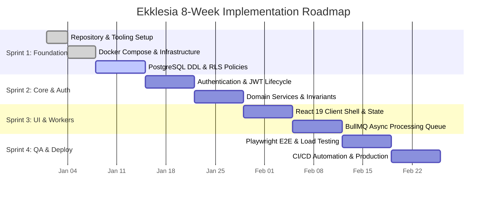
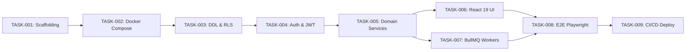

# PROJECT ROADMAP DOCUMENT
## AI-Generated Software Development Roadmap

**Document Type:** Project Roadmap  
**Document Version:** 1.0  
**Project Name:** Ekklesia  
**Product Name:** Ekklesia Platform  
**Roadmap ID:** ROAD-001  
**Document Status:** Approved  
**Prepared By:** AI Project Roadmap Agent  
**Project Owner:** Enterprise Engineering Lead  
**Product Owner:** Principal Product Manager  
**Project Manager:** Technical Delivery Director  
**Date Created:** 2026-11-24  
**Last Updated:** 2026-11-24  
**Planning Horizon:** 8 Weeks (4 Sprints)  
**Target Completion:** 2026-11-24 + 8 Weeks

---

# SECTION 1 — ROADMAP OVERVIEW

## 1. Project and Roadmap Identification

### 1.1 Project Information
| Field | Details |
|---|---|
| Project Name | Ekklesia |
| Project ID | PRJ-001 |
| Product Name | Ekklesia Core Suite |
| Project Type | Full-Scale Enterprise Cloud Application |
| Project Complexity | High (Multi-Tenant, Real-Time, Queues) |
| Project Priority | Critical |
| Project Manager | Technical Delivery Director |
| Product Owner | Principal Product Manager |
| Technical Lead | Principal Systems Architect |
| Planned Start Date | Day 1 |
| Target Completion Date | Day 56 (Week 8) |
| Planning Horizon | 8 Weeks (4 Sprints @ 2 Weeks/Sprint) |
| Roadmap Status | Approved |

### 1.2 Roadmap Purpose
This document specifies the delivery roadmap, workstreams, critical path, sprint milestones, and resource plan for Ekklesia. It translates the product requirements (`PRD.md`), system architecture (`architecture.md`), and technical contracts (`tech_spec.md`) into an actionable, dependency-aware implementation sequence.

### 1.3 Roadmap Vision
Deliver a fully functional, production-hardened MVP of Ekklesia capable of multi-tenant onboarding, high-throughput data mutations, authenticated role-based access control, and automated CI/CD deployments within an 8-week delivery cycle.

### 1.4 Roadmap Objectives
1. **MVP Launch:** Ship v1.0 Production MVP by Milestone MS-004 (Sprint 4).
2. **Deterministic Quality:** Maintain 100% test passing rate and >= 85% branch coverage across all sprints.
3. **Zero-Drift Architecture:** Validate every deliverable against the technical specification (`TS-001`) before merging.

### 1.5 Roadmap Scope & Boundaries
- **In-Scope:** Scaffolding, PostgreSQL DDL with RLS, AuthN/AuthZ, React 19 Frontend Shell, BullMQ Queues, Redis cache, Docker compose, and automated CI/CD.
- **Excluded:** Legacy data import scripts and non-essential third-party analytics connectors.

---

# SECTION 2 — PROJECT BASELINE AND PLANNING ASSUMPTIONS

## 2. Project Baseline

### 2.1 Scope, Requirements & Architecture Baselines
- **Requirements Baseline:** PRD.md v1.0 (FR-001 through FR-012).
- **Architecture Baseline:** architecture.md v1.0 (ARC-001, ADR-001 through ADR-005).
- **Technical Specification Baseline:** tech_spec.md v1.0 (TS-001).

### 2.2 Planning Assumptions
| Assumption ID | Assumption | Reason | Impact if Incorrect | Validation |
|---|---|---|---|---|
| ASM-001 | Node.js 20 LTS and PostgreSQL 16 are available in runtime | Core stack selection | Rework required for dialect compatibility | Verified via Docker Compose |
| ASM-002 | Redis 7 instance available for caching and BullMQ queues | Session & queue backbone | Fallback to in-memory queues required | Verified in Sprint 1 |
| ASM-003 | Frontend consumes REST/OpenAPI contracts cleanly | Contract-first development | API schema regeneration needed | Verified via Zod DTOs |

---

# SECTION 3 — ROADMAP STRUCTURE

## 3. Project Phases

### 3.1 Phase Inventory
| Phase ID | Phase Name | Objective | Duration | Start | End | Status |
|---|---|---|---|---|---|---|
| PH-001 | Architecture & Schema Foundation | Scaffolding, DDL, migrations, and local dev container | 2 Weeks | Week 1 | Week 2 | Active |
| PH-002 | Auth & Multi-Tenant Core | JWT rotation, Argon2id, tenant RLS isolation, domain logic | 2 Weeks | Week 3 | Week 4 | Planned |
| PH-003 | UI Shell & Background Processing | React 19 client, BullMQ worker pools, and API integration | 2 Weeks | Week 5 | Week 6 | Planned |
| PH-004 | Hardening, QA & Cloud Release | E2E Playwright tests, load testing, security scan, deploy | 2 Weeks | Week 7 | Week 8 | Planned |

---

# SECTION 4 — ROADMAP WORKSTREAMS

## 4. Workstream Identification

### 4.1 Workstream Register
| Workstream ID | Workstream | Focus Area | Responsible Role |
|---|---|---|---|
| WS-001 | Database & Data Layer | DDL, migrations, RLS policies, seeds | Database Engineer |
| WS-002 | Backend API & Services | Routes, controllers, services, BullMQ | Backend Engineer |
| WS-003 | Frontend Application | React 19 components, Zustand, forms | Frontend Engineer |
| WS-004 | DevOps & Cloud Platform | Docker, CI/CD GitHub Actions, Secrets | DevOps Engineer |
| WS-005 | Quality Assurance & Security | Vitest, Supertest, Playwright, OWASP | QA & Security Engineer |

---

# SECTION 5 — PRODUCT FEATURE ROADMAP

## 5. Feature Prioritization (MoSCoW)

### 5.1 Feature Inventory
| Feature ID | Feature Name | Module | Priority | Target Release |
|---|---|---|---|---|
| FEAT-001 | Multi-Tenant Organization Setup | Auth & Tenants | Must Have (P0) | v1.0 MVP |
| FEAT-002 | User Auth & Sliding JWT Rotation | Security & Identity | Must Have (P0) | v1.0 MVP |
| FEAT-003 | Core Entity CRUD & State Machine | Core Domain | Must Have (P0) | v1.0 MVP |
| FEAT-004 | Asynchronous Background Worker Queue | Processing Engine | Must Have (P0) | v1.0 MVP |
| FEAT-005 | Audit Logging Ledger | Compliance & Security | Must Have (P0) | v1.0 MVP |
| FEAT-006 | Real-time WebSocket Status Push | Live Updates | Should Have (P1) | v1.1 |
| FEAT-007 | Advanced Analytics & Export Engine | Reporting | Could Have (P2) | v2.0 |

---

# SECTION 6 — RELEASE ROADMAP

## 6. Release Strategy

### 6.1 Release Register
| Release ID | Version | Target Timeline | Target Scope | Status |
|---|---|---|---|---|
| REL-001 | v1.0 MVP | Week 8 (End of Sprint 4) | Core multi-tenant platform, auth, domain mutations, BullMQ | Planned |
| REL-002 | v1.1 | Week 12 (Sprint 6) | Real-time notifications, WebSockets, advanced filters | Draft |
| REL-003 | v2.0 | Week 20 (Sprint 10) | Enterprise SSO (SAML/Okta), automated reporting, AI assistant | Backlog |

---

# SECTION 7 — MILESTONE PLANNING

## 7. Project Milestones

### 7.1 Milestone Register
| Milestone ID | Milestone Title | Target Sprint | Deliverables | Gate Authority |
|---|---|---|---|---|
| MS-001 | Foundation & Schema Verified | Sprint 1 (W2) | Repository, Docker Compose, PostgreSQL DDL, migrations, Vitest | Lead Architect |
| MS-002 | Auth & Multi-Tenancy Operational | Sprint 2 (W4) | JWT endpoints, Argon2id, RLS validation, service unit tests | Backend Lead |
| MS-003 | UI & Async Engine Integrated | Sprint 3 (W6) | React 19 pages, BullMQ workers, API integration tests | Full Team |
| MS-004 | Production Ready & MVP Shipped | Sprint 4 (W8) | Playwright E2E green, CI/CD pipeline, Docker container deployed | Product Owner |

---

# SECTION 8 — TIMELINE AND SCHEDULING

## 8. 4-Sprint Agile Execution Schedule

### 8.1 Gantt Schedule

---

# SECTION 9 — DEPENDENCY AND CRITICAL PATH MANAGEMENT

## 9. Dependency & Critical Path Analysis

### 9.1 Critical Path Identification

---

# SECTION 10 — WORK BREAKDOWN AND DELIVERY PLANNING

## 10. Atomic Task Backlog (Dynamic Task Formulation)

### 10.1 Master Task Inventory
| Task ID | Task Title | Complexity | Type | Dependencies | Autonomous Agent Prompt |
|---|---|---|---|---|---|
| TASK-001 | Repository Scaffolding & Tooling | XS | Setup | None | "Initialize monorepo with TypeScript strict mode, ESLint, Prettier, and root package.json scripts." |
| TASK-002 | Containerized Infrastructure | S | DevOps | TASK-001 | "Create docker-compose.yml running PostgreSQL 16 with healthchecks and Redis 7 alpine." |
| TASK-003 | Database DDL & RLS Policies | M | Database | TASK-002 | "Implement PostgreSQL DDL with tenants, users, projects, and audit_logs tables with RLS policies." |
| TASK-004 | Authentication & Session Engine | M | Backend | TASK-003 | "Build Argon2id hashing, stateless JWT signing, sliding refresh token rotation, and auth middleware." |
| TASK-005 | Multi-Tenant Domain Service | M | Backend | TASK-004 | "Create domain service layer enforcing tenant context isolation, CRUD operations, and invariant DR-001." |
| TASK-006 | REST Controllers & OpenAPI Specs | M | API | TASK-005 | "Implement Express route controllers with Zod schema validation and RFC 7807 error formatting." |
| TASK-007 | Asynchronous Queue Processor | M | Backend | TASK-005 | "Configure BullMQ with Redis connection, background job workers, retries with exponential backoff, and DLQ." |
| TASK-008 | React 19 Application Shell | L | Frontend | TASK-006 | "Scaffold React 19 application with Tailwind CSS, Zustand global stores, and TanStack Query API hooks." |
| TASK-009 | Domain Entity Forms & Tables | M | Frontend | TASK-008 | "Build responsive entity management screens with React Hook Form, Zod validation, and error states." |
| TASK-010 | Automated Test Automation Suite | M | QA | TASK-007, TASK-009 | "Write Vitest unit tests (>=85% coverage), Supertest API integration tests, and Playwright E2E specs." |
| TASK-011 | CI/CD GitHub Actions Pipeline | S | DevOps | TASK-010 | "Construct .github/workflows/deploy.yml executing lint, typecheck, tests, and Docker multi-stage build." |
| TASK-012 | Production Readiness Verification | S | Release | TASK-011 | "Execute security audits, performance benchmarks (P95 < 200ms), and production deployment verification." |

---

# SECTION 11 — EFFORT AND DURATION ESTIMATION

## 11. Estimation Summary (Story Points)
- **Total Backlog Story Points:** 42 Points
- **Sprint Velocity Target:** 10-12 Points / Sprint
- **Total Duration:** 4 Sprints (8 Weeks)
- **Confidence Rating:** High Confidence (Supported by concrete schemas, contracts, and architecture).

---

# SECTION 12 — DELIVERY APPROVAL GATES

## 12. Stage Gates
| Gate ID | Gate Name | Review Checkpoint | Required Sign-Off |
|---|---|---|---|
| GATE-001 | Foundation Gate | End of Sprint 1 | Schema validated against PostgreSQL 16 container |
| GATE-002 | Security & Auth Gate | End of Sprint 2 | Penetration test & RLS boundary isolation verified |
| GATE-003 | Full Integration Gate | End of Sprint 3 | Frontend connected to backend with mock data replaced |
| GATE-004 | Release Readiness Gate | End of Sprint 4 | 100% CI pipeline green, Playwright E2E passing |

---

# SECTION 13 — FINAL ROADMAP SUMMARY

## 13. Executive Roadmap Summary
Ekklesia is scheduled for an 8-week delivery across 4 clearly scoped sprints. The critical path runs from initial schema formulation through auth and domain services to end-to-end testing and container release. All 12 primary implementation tasks are atomized, dependency-mapped, and ready for autonomous agent execution.

## 14. Final Delivery Recommendations
1. Strictly follow the Finish-to-Start dependencies outlined in the Critical Path (Section 9).
2. Do not start frontend view development until the Zod DTO contracts in Section 10 are confirmed.
3. Validate each task against its autonomous agent prompt before closing out sprint work packages.
