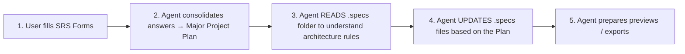

# Specification Generation Protocol Audit

## Required Protocol (Your Vision)



---

## Current Implementation vs. Protocol

| Step | Protocol Requirement | Current Status | Violation? |
|:---:|:---|:---|:---:|
| **1** | User fills up SRS forms | ✅ `WizardForm.tsx` — 15-section, 71-field questionnaire collects `SRSFormData` | None |
| **2** | Agent consolidates answers → generates Major Project Plan | ⚠️ **Partially Correct** — `generateProjectPlanDraft()` calls AI with form data and produces a draft, **but it also extracts tasks immediately**, mixing steps 2 and 4 | **Yes** |
| **3** | Agent reads `.specs` folder to understand architecture rules | ❌ **MISSING** — The agent never reads `SPEC_TIERS`, the frontmatter rules, or the regeneration cascade rules before compiling files. It jumps straight from draft to file generation. | **Yes** |
| **4** | Agent updates .specs files based on the Major Project Plan | ⚠️ **Partially Correct** — `synthesizeSpecsSuite()` → `buildCanonicalSpecsSuite()` does use `extractSectionFromDraft()` to pull AI draft sections into templates. But it doesn't first consult the `.specs` architecture rules to understand *what* each file expects, *what dependencies* to follow, or *what regeneration cascades* apply. | **Yes** |
| **5** | Agent prepares for previews or exports | ✅ `AgentGenerationViewport.tsx` streams logs, then `DocumentPreview.tsx` + `downloadSpecsZip()` + MCP Hub handle preview/export | None |

---

## Detailed Violation Analysis

### Violation 1: Steps 2+4 are conflated — Tasks extracted too early

**Where:** [`specGeneratorService.ts` L545](file:///d:/PROJECTS/srs_genie/services/specGeneratorService.ts#L545)

```typescript
// Inside generateProjectPlanDraft():
const dynamicTasks = generateDynamicProjectTasks(input);  // ← extracted from RAW FORM, not from the Plan
```

The protocol says the Agent should:
1. First generate the Major Project Plan from consolidated answers
2. Then read the .specs architecture
3. **Then** derive tasks from the Plan (not directly from raw form fields)

Currently, `generateDynamicProjectTasks()` reads `input.formData` directly. The tasks are pattern-matched from raw checkbox selections (`hasEcommerce`, `hasComms`, `has2FA`, etc.) — they don't derive from the AI-generated Plan at all.

### Violation 2: No "Read .specs architecture" phase exists

**Where:** [`specGeneratorService.ts` L876–L888](file:///d:/PROJECTS/srs_genie/services/specGeneratorService.ts#L876-L888)

```typescript
// Phase 1: Generate Master Project Plan Draft & Extract Dynamic Tasks
const { draft, dynamicTasks } = await generateProjectPlanDraft(input, modelDef, onProgress);

// Phase 2: Compile the 22 canonical .specs files derived from the draft
const synthesized = synthesizeSpecsSuite(input, dynamicTasks, draft, onProgress);
```

There is **no Phase between these two** where the agent inspects the `.specs` tier metadata (`SPEC_TIERS`), reads the frontmatter rules (`depends-on`, `triggers-regen`, `role`), or understands the regeneration cascade before deciding how to populate each file.

The `SPEC_TIERS` constant at the top of the file defines the 22-file architecture with paths, tiers, and descriptions — but it's only used for the **UI sidebar rendering** in `AgentGenerationViewport.tsx` and `DocumentPreview.tsx`. It's never consulted by the generation engine itself.

### Violation 3: `buildCanonicalSpecsSuite` populates templates, not "updates based on plan"

**Where:** [`specTemplates.ts` L89–L101](file:///d:/PROJECTS/srs_genie/services/specTemplates.ts#L89-L101)

The function does call `extractSectionFromDraft()` to inject AI-generated sections into templates (good!), but:
- It doesn't read the `.specs` architecture rules first
- It doesn't check `depends-on` chains to determine file generation order
- It doesn't apply `triggers-regen` cascades
- It doesn't verify that downstream files are consistent with upstream changes

### Violation 4: Viewport phases don't match the protocol

**Where:** [`App.tsx` L247–L253](file:///d:/PROJECTS/srs_genie/App.tsx#L247-L253)

Current phases are:
```
1. Intake & Requirement Validation
2. Master Project Plan Synthesis
3. Dynamic Task Extraction & Dependencies   ← should come AFTER reading .specs
4. Multi-Tier .specs Hierarchy Compilation   ← MISSING: "Read .specs architecture" phase before this
5. Verification & Package Finalization
```

Protocol phases should be:
```
1. Intake & Requirement Consolidation
2. Master Project Plan Synthesis (AI Draft)
3. Reading .specs Architecture Rules         ← NEW
4. Updating .specs Files from Plan           ← includes dynamic task extraction
5. Verification & Package Finalization
```

---

## Required Corrections

### Fix 1: Separate Plan generation from Task extraction

`generateProjectPlanDraft()` should ONLY produce the Major Project Plan text. Tasks should be extracted AFTER the `.specs` rules are read and the Plan is analyzed — not from raw form data.

### Fix 2: Add explicit ".specs Architecture Reading" phase

Create a new function that:
1. Iterates `SPEC_TIERS` to understand the 22-file hierarchy
2. Reads each file's `depends-on` and `triggers-regen` rules from frontmatter
3. Determines the correct generation order (dependency DAG)
4. Builds a "compilation plan" that maps Plan sections to spec files
5. Emits progress logs for the viewport showing which rules the agent found

### Fix 3: Derive tasks from the Plan, not raw form

Instead of `generateDynamicProjectTasks(input)` scanning raw checkboxes, the agent should:
1. Send the Major Project Plan back to the AI engine with instructions to decompose it into atomic tasks
2. Or at minimum, use `extractSectionFromDraft()` to pull task-relevant sections and build tasks from Plan content

### Fix 4: Update viewport phases to match protocol

```typescript
export type GenerationPhaseId = 
  | 'intake'           // 1. Consolidate form answers
  | 'drafting_plan'    // 2. Generate Major Project Plan
  | 'reading_specs'    // 3. Read .specs architecture rules  ← NEW
  | 'updating_specs'   // 4. Update .specs files from Plan
  | 'finalizing';      // 5. Verify & package for preview/export
```

---

> [!IMPORTANT]
> The core architectural issue is that the system currently treats `.specs` as an **output format** (a template to fill), not as an **architecture the agent must understand first before updating**. The protocol demands the agent behave like an autonomous architect: read the blueprint, understand the rules, then apply the plan to update each section correctly.

